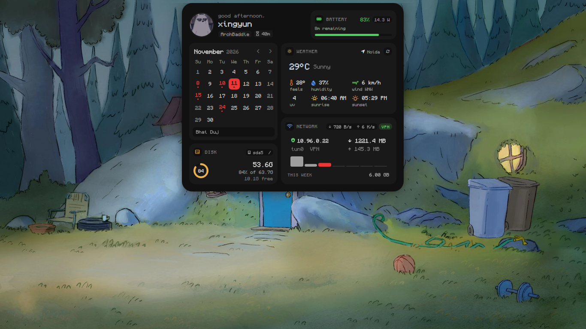
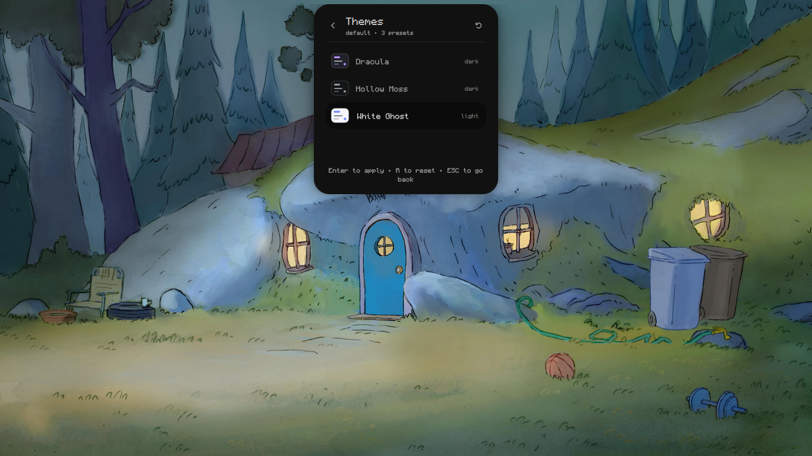

# ChillPill-Shell

<div align="center">

[](https://github.com/LUCKYS1NGHH/ChillPill-Shell/releases)
[](https://github.com/LUCKYS1NGHH/ChillPill-Shell/stargazers)
[](https://github.com/quickshell-mirror/quickshell)
[](https://www.gnu.org/licenses/gpl-3.0)

</div>

<p align="center">
  <a href="https://trendshift.io/repositories/81167?utm_source=trendshift-badge&amp;utm_medium=badge&amp;utm_campaign=badge-trendshift-81167" target="_blank" rel="noopener noreferrer"></a>
  <a href="https://trendshift.io/repositories/81167?utm_source=trendshift-badge&amp;utm_medium=badge&amp;utm_campaign=badge-trendshift-81167" target="_blank" rel="noopener noreferrer"></a>
</p>

<div align="center">

ChillPill-Shell is a **lightweight**, **feature-rich** dynamic pill bar for Hyprland, built with **Quickshell**.
It's aimed squarely at users running without a dedicated GPU (like me) — eye candy that doesn't cost you a discrete card. Runs great on integrated graphics.

It runs as a **standalone app**: launch it from your terminal or app launcher when you want it, rather than having it baked
into your session at all times. It's not bound to any dotfiles.

</div>

<div align="center">

[](#resource-usage)
[](#showcase)
[](#features-pill-states)
[](#configuration-app)
[](#lockscreen-optional)
[](#dependencies)
[](#install)
[](#auto-startup)
[](#key-bindings)
[](#co-cookers)

</div>

---

### Resource Usage

- RAM: 200-500 MB (Average 400)
- CPU: Idle 0%, Average 3%, Min 0.1%, Max 8%
- GPU: Idle 0%, Average 15%, Min 6%, Max 40%

> CPU and GPU usage varies with system; a faster CPU and GPU use less.

#### My Hardware

- RAM: 8GB (DDR3)
- CPU: i5 3337U (Dual-core)
- GPU: Intel HD 4000 (Integrated)

---

### Showcase

[Watch the demo on YouTube](https://www.youtube.com/watch?v=t7ydMT4F478)

<div align="center">

<strong>Pill bar · Control Center</strong><br>


<strong>Clipboard manager · Full preview</strong><br>


<strong>Dashboard · Theme Picker</strong><br>



<strong>Wi-Fi · Bluetooth states</strong><br>


<strong>Spotlight · Media Popup</strong><br>


<strong>Wallpaper switcher · Power menu</strong><br>


</div>

## Features (Pill States)

- **Main pill bar**                  - Battery, volume, workspaces, network, clock (default; fully customizable in the config app) — for more module options, see 'Know more' below, including system tray modules.
- **Control center**                 - Media player, buttons (WiFi, Silent Notifs, Timer, Bluetooth), volume & brightness sliders, notification stack
  - **Wifi state**                   - List of available networks, hero card, password prompt, forget prompt, USB tethering, network info (band, signal strength and security), refresh networks button etc.
  - **Bluetooth state**              - List of available devices, hero card, tips in footer, refresh devices button etc.
- **Cliphist (clipboard manager)**   - Search (optional fuzzy search), clipboard image preview, item index status, multi select to delete many items at once (<kbd>Shift</kbd> + <kbd>Up</kbd>/<kbd>Down</kbd> range, <kbd>Shift</kbd> + <kbd>Space</kbd> pick, <kbd>Del</kbd> to delete), <kbd>Tab</kbd> to full preview the clipboard image/text, <kbd>Shift</kbd> + <kbd>Up</kbd>/<kbd>Down</kbd> to scroll multi lines clipboard text in full preview
- **Dashboard**                      - Profile image, username, hostname, uptime, battery tile, network tile, calendar tile, weather tile, disk tile.
- **Spotlight**                      - List of applications (<kbd>Tab</kbd> to read the long app description), optional fuzzy search for apps, web search (<kbd>Tab</kbd> to expand the full search url), math and shell commands run
- **DBus notification**              - App icon (optional), summary, body (YES! you can ditch swaync/dunst fully now)
- **OSD**                            - Battery, volume, brightness, timer
- **Wallpaper switcher**             - <kbd>.</kbd> or <kbd>CTRL</kbd> + <kbd>H</kbd> to see hidden images (dot prefixed)
- **Power menu**                     - 5 actions (Lock, Sleep, Logout, Restart, Shutdown) and action confirmation prompt
- **Theme picker**                   - One-click live theme switching from the pill

<details>
<summary>Know more</summary>

---
- Main pill bar modules have tooltips

- Extra modules available for the pill bar beyond the defaults: `weather`, `bluetooth`, `vpn`, `notifications`, `brightness`, `audioVisualizer`

- Pill bar supports custom modules (waybar-style) — run any command/script in the bar with `format`/`tooltip` templates, refresh intervals, streaming output and click actions (see [Custom pill modules](#custom-pill-modules)).

- 3 pill states are open-able with mouse:

  - Control center: <kbd>Left click</kbd>
  - Cliphist: <kbd>Middle click</kbd>
  - Dashboard: <kbd>Right click</kbd>

  For the rest of states, you have to call the IPC through keybinds in Hyprland, which are provided in [Keybinds](#key-bindings)
  section (including the mouse open-able states)

- DPI and Pill scaling is available in the config if you need it.

- Audio, workspaces, bluetooth and wifi in pill bar are clickable.

- Control center's media player progress bar is not only for status, it's usable to control the media you are playing.
  Timer minutes can be changed by right click, and you can hold-to-burst (stop) to halt the running timer.

- The live audio spectrum (needs `cava`) is drawn in two independent flavours: bottom-anchored in the control center's
  media player (toggled by `showAudioVisuals`), and mirrored around its middle line (a wave instead of a skyline)
  as the `audioVisualizer` pill bar module (toggled by adding/removing it from `pillModules`). Either one can be used
  without the other.

- Control center has a Wi-Fi state which has a list of active networks with a password prompt, including USB tethering.

- Control center also has a Bluetooth controller which lists the active, pairable & connected devices/networks and device battery. here's 3 cases to connect a bluetooth device first time:

  - case 1: device wants a PIN or passkey typed in
  - case 2: device just wants us to display a code
  - case 3: device wants a yes/no confirmation of a shown passkey

- Cliphist shows image previews from `~/.cache/chillpill-shell/cliphist-imgs` by converting image binaries into real images and saving them there. If
  you want this image cache to auto delete when you delete the cliphist (clipboard manager) image item, there's the `deleteCliphistImgCache` config
  option (enabled by default).

- Cliphist image full preview tab supports image drag and drop, drop the image anywhere you want, or just drop it on your desktop screen to
  apply the image as wallpaper.

- In Cliphist full preview tab (which opens through <kbd>Tab</kbd> key), you can switch to other item by <kbd>Up</kbd>/<kbd>Down</kbd> keys,
  and can also delete the item from there. Full preview tab also shows previous/next item type (Image / Text) badges in bottom area,
  only if you toggle off the `separatePreviewTabTypes` (enabled by default).

- Cliphist items can be multi selected through keys, then deleted in one go with <kbd>Del</kbd>:

  - <kbd>Shift</kbd> + <kbd>Up</kbd> / <kbd>Shift</kbd> + <kbd>Down</kbd>: mark a range of items, editor style (grows and shrinks from where the range started)
  - <kbd>Shift</kbd> + <kbd>Space</kbd>: mark/unmark the item under the cursor (works in the full preview too, the marked count shows as a chip there)
  - <kbd>Ctrl</kbd> + <kbd>Click</kbd> / <kbd>Shift</kbd> + <kbd>Click</kbd>: same toggle with the mouse
  - <kbd>Del</kbd>: deletes the marked items, or the highlighted one when nothing is marked
  - <kbd>Esc</kbd>: drops the marks first, closes the panel on the second press

- Notifications, brightness and volume are able to show in slide animation (similar to iOS mute) while you are playing a video game or watching a movie
  in full screen.

- Your today's data usage in Dashboard is shown by [nusgmon](https://github.com/LUCKYS1NGHH/nusgmon) (i am the creator of it too).

- Wallpaper switcher shows you the filename of the image on hover, and uses `awww` in the backend to update the wallpaper by default (optional dep).
---
</details>

## Configuration App
> Raw config is still located at `~/.config/chillpill-shell/config.jsonc`

The GUI writes that same file, every option lives on one of these pages, and the search bar at the
top filters every visible setting across them.


## Lockscreen (Optional)
> Default lockscreen app - authenticates through PAM's `login` service and uses the
> Wayland session-lock protocol, so it is safe on Wayland compositors (Hyprland, Sway, river etc.)


### Running it

Power menu's **Lock** action and any keybind using that config option use:

```bash
chillpill-lock                                     # lock now, quits after you unlock
LOCK_WALLPAPER=~/Pictures/wall.png chillpill-lock  # lock with a specific wallpaper
```

### Environment variables

| Variable | Effect |
|---|---|
| `LOCK_NOW=1` | Lock immediately on start and quit after unlocking (what `chillpill-lock` does) |
| `LOCK_WALLPAPER=<path>` | Use this image instead of the detected one (blurred behind the card) |

> [!WARNING]
> Never `kill` a running lockscreen instance. Destroying a session-lock surface while locked makes Hyprland drop to
> its pookie crash lockscreen. Unlock it properly, or quit the process only while it is idle in standby.

### Config

No separate lock config, it reads `~/.config/chillpill-shell/config.jsonc` and the palette through `Theme.qml`,
so these existing options apply: `displayPicture`, `textFontFamily`, `nerdFontFamily`, `dpiScale`, `showShadows` etc.

`lockscreenPowerActions` (default `true`, toggle in the config app under **System -> Lockscreen power buttons**) shows
the suspend / restart / shutdown buttons on the card. Turn it off on shared machines so nobody at the lock screen can
shut the box down with your work still unsaved.

`lockscreenMedia` (default `true`, **System -> Lockscreen media player**) drops the regular media player card into the
clock box under the greeting - the control center uses, with cover art, seekable
progress bar and working prev / play-pause / next.

The wallpaper is `$LOCK_WALLPAPER`, else `~/.cache/chillpill-shell/last_wallpaper`.

## Theming

Open the **Theme picker** (default <kbd>MOD</kbd> + <kbd>T</kbd>, bindable from the config app's Keybinds page), every preset in `~/.cache/chillpill-shell/themes/*.json`.

A theme is a plain JSON file of colors, so every key mirrors a property in `Theme.qml` (`bg`, `fg`, `accent`, `ok`, `danger`, ...), so you can write your own preset without touching the shell. Drop it in the themes DIR and it appears in the picker on next open.

```bash
qs ipc -p /usr/share/chillpill-shell call theme toggle           # open the picker
qs ipc -p /usr/share/chillpill-shell call theme apply whiteghost
qs ipc -p /usr/share/chillpill-shell call theme apply ""         # back to the OG dark theme
```

## Custom Pill Modules

Besides the built-in Quickshell modules (`battery`, `workspaces`, `network`, `clock`, `vpn`, `notifications` etc.), `pillModules` also accepts
**object entries** that run any command/script and show its output in the bar — kind of similar to
[waybar's custom module](https://github.com/Alexays/Waybar/wiki/Module:-Custom).

| Key | Description |
|---|---|
| `run` | Command to execute **(required)**. Just pass the script name if it's in `~/.config/chillpill-shell/modules`, else with leading `~` or absolute path |
| `icon` | Optional nerdfont icon, referenced in `format`/`tooltip` as `{icon}` |
| `format` | Text shown in the bar. Supports `{text}` / `{tooltip}` / `{icon}` placeholders. Default: `{icon} {text}` (or just `{text}` without an icon) |
| `tooltip` | Tooltip shown on hover. Supports `{text}` / `{tooltip}` / `{icon}` placeholders. Default: the output's tooltip |
| `every` | Refresh every N seconds. Omit (or `0`) to run once at startup |
| `stream` | Keep the process running and update the module on every stdout line (`true`) |
| `click` | Command run on left click |

The command may print **plain text** (used as `{text}`) or a **JSON object** per run / per line:

```json
{ "icon": "", "color": "#6d9fd7", "text": "45°C", "tooltip": "45°C CPU Temperature" }
```

A sample script ships in the repo and gets installed to
`~/.config/chillpill-shell/modules/`: `cpu-temp.sh` (one-shot CPU temperature,
prints a temperature-dependent `{icon, color, text, tooltip}` JSON line).
Scripts in that directory can be referenced by their plain file name, so
`"run": "cpu-temp.sh"` works, scripts living anywhere else need a `~` path or an absolute one.
Use your custom scripts to see specific/niche info in ChillPill-Shell's Pill Bar.

## Dependencies
> [!NOTE]
> Tested on **Arch Linux** and **NixOS** + **Hyprland**. Package names are Arch's.
> `install.sh` handles everything below for Arch users.

<details>
<summary>What each package powers</summary>

---

| Package | Powers |
|---|---|
| [Quickshell](https://quickshell.org/) | The whole shell - bar, states, config app |
| [cliphist](https://github.com/sentriz/cliphist) | Pill bar · Cliphist (clipboard manager) state |
| [nusgmon](https://github.com/LUCKYS1NGHH/nusgmon) | Dashboard · today's data usage |
| [brightnessctl](https://github.com/Hummer12007/brightnessctl) | Brightness module, slider and OSD |
| [wl-clipboard](https://github.com/bugaevc/wl-clipboard) | Wayland clipboard I/O |
| [inotify-tools](https://github.com/inotify-tools/inotify-tools) | File watchers (wallpaper switch, notification sounds) |
| [pipewire](https://github.com/PipeWire/pipewire) | Audio server (volume, media player, visualizer) |
| [blueman](https://github.com/blueman-project/blueman) | Bluetooth manager state |
| Qt Multimedia (`qt6-multimedia`) | For notification popup sound |
| [python-psutil](https://github.com/giampaolo/psutil) | Data usage in the Dashboard |

---
</details>

**Optional** - the core shell runs fine without them:

```bash
paru -S --needed ttf-jetbrains-mono-nerd qt6-imageformats cava awww   # font, image formats, audio spectrum, wallpaper backend
pip install holidays                                                  # calendar event dates (install.sh prompts for this)
```

<details>
<summary>Optional packages explained</summary>

---

- **Fonts** - Monocraft (`ttf-monocraft-git` / `ttf-monocraft-nerd`) or JetBrainsMono Nerd Font (`ttf-jetbrains-mono-nerd`); pick one in **Appearance**
- **`qt6-imageformats`** - WEBP & friends for the wallpaper previews
- **`holidays`** (Python lib) - event dates in the calendar popup (**Weather & Data** page configures it)
- **`cava`** - live audio spectrum (control center visuals / `audioVisualizer` pill module)
- **`awww`** - wallpaper switcher backend, if you don't use your own wallpaper script

---
</details>

<details>
<summary>Holidays configuration</summary>

---

Configured under **Weather & Data** in the config app: `Country` picks the
nation, `Holidays` is the master toggle, `All categories` includes every category the
country supports, `Categories` takes a comma-separated list (e.g. `public,optional`),
and `Subdivision` narrows it to a state/province code (e.g. `MH`). These map straight to
`calendar_events.py --all / --categories / --subdiv`, and the cache filename changes with
them so switching preferences never shows stale data.

---
</details>

## Install

> [!TIP]
> Use my Hyprland [dotfiles](https://github.com/LUCKYS1NGHH/dotfiles), it's also made for No Dedicated GPU machines.
> You will get better performance.

#### Arch users (AUR)

```bash
paru -S chillpill-shell
```

#### NixOS users (flake with Home Manager)

Add this repository as an input to your flake:

```nix
{
  inputs = {
    chillpill-shell = {
      url = "github:LUCKYS1NGHH/chillpill-shell";
      inputs.nixpkgs.follows = "nixpkgs";
    };
  };
}
```

Enable and configure it in your Home Manager configuration:

```nix
{ chillpill-shell, ... }:
{
  imports = [
    chillpill-shell.homeManagerModules.default
  ];

  programs.chillpill-shell = {
    enable = true;
    settings = {
      clockFormat = "HH:mm";
      # Other options from config.jsonc
    };
  };
}
```

#### Other
```bash
git clone --depth=1 https://github.com/LUCKYS1NGHH/ChillPill-Shell.git
cd ChillPill-Shell
chmod +x install.sh
sudo ./install.sh # use --skip-deps to skip dependencies installation (arch currently)
```

<details>
<summary>Uninstall?</summary>

---

#### AUR
```bash
paru -R chillpill-shell
```

#### Other
```bash
chmod +x uninstall.sh
sudo ./uninstall.sh
```

---
</details>

### Auto startup

To auto-run ChillPill-Shell whenever Hyprland starts, paste this code in your `~/.config/hypr/hyprland.lua` config file

```lua
hl.on("hyprland.start", function()
   hl.exec_cmd("chillpill-shell")
end)
```

## Key Bindings

Keybindings are highly recommended for ChillPill-Shell in your Hyprland config. They call the shell's IPC to toggle its pill states — adjust the key combinations to your preferences.

| State (IPC target) | Example Keybinds | Opens |
|---|---|---|
| `controlCenter` | `MOD + CTRL + C` | Media, sliders, buttons, notifications |
| `cliphist` | `MOD + CTRL + V` | Clipboard history |
| `dashboard` | `MOD + CTRL + B` | Profile, weather, data usage, calendar etc. |
| `spotlight` | `MOD + D` | Apps list to open, web search, math and basic shell run |
| `wallpaperSwitcher` | `MOD + W` | Wallpaper switcher |
| `powerMenu` | `MOD + Escape` | Power menu actions |
| `wifiState` | `MOD + SHIFT + W` | Wi-Fi State |
| `bluetoothState` | `MOD + SHIFT + B` | Bluetooth State |
| `theme` | `MOD + T` | Theme Picker |

`MOD` is the `mainMod` variable (typically <kbd>SUPER</kbd> key) from your config, e.g. `hl.bind(mainMod .. " + D", hl.dsp.exec_cmd("qs ipc -p /usr/share/chillpill-shell call spotlight toggle"))`.
On NixOS the command is `chillpill-shell-ipc call <state> toggle` instead of `qs ipc -p /usr/share/chillpill-shell`

```bash
qs ipc -p /usr/share/chillpill-shell call <target> <toggle|show|hide>
```

> [!TIP]
> The config app can auto-paste these binds into `~/.config/hypr/hyprland.lua` in one click — open the **Keybinds** page and press *Auto paste keybinds*.

---

### Co-cookers

Thanks to the Co-cookers (contributors) who helped make the shell better and are continuing it, and special thanks to [enhaoswen](https://github.com/enhaoswen) for the Wi-Fi controller backend for Quickshell.

<a href="https://github.com/LUCKYS1NGHH/chillpill-shell/graphs/contributors">
  
</a>

### Cooked by

LUCKYS1NGHH / https://github.com/LUCKYS1NGHH/ChillPill-Shell
